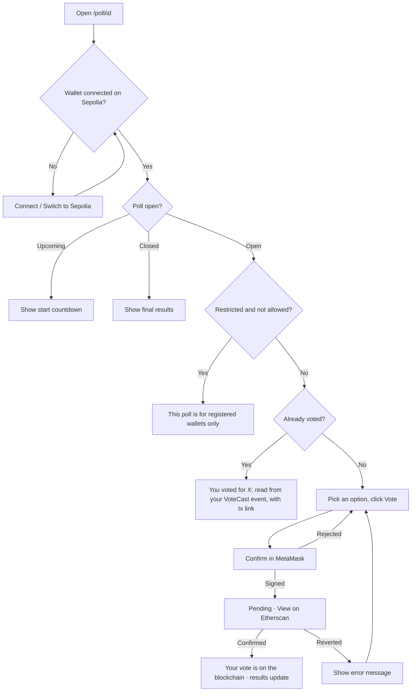

# App Flow: Botohan

## Routes

| Route | Who | Purpose |
| --- | --- | --- |
| `/` | Everyone | List of polls, grouped Open / Upcoming / Closed, newest first |
| `/poll/[id]` | Everyone | Vote and see live results |
| `/poll/[id]/present` | Presenter | Full-screen projector view with QR code |
| `/admin` | Owner only | Create poll, add voters, close poll |

A header on every page: app name (links to `/`), network badge, connect/disconnect button.

## Wallet and network states

| State | What the user sees |
| --- | --- |
| No wallet installed | "Install MetaMask to vote" with a link to metamask.io/download. Results still visible |
| Not connected | **Connect wallet** button |
| Connected, wrong network | "Switch to Sepolia" button (`useSwitchChain`) |
| Connected on Sepolia | Short address `0x1c4…9A3C`, **Disconnect** |

Results and the feed are always readable without a wallet.

## Flow 1: Vote

### Vote button states

| State | Button label | Extra |
| --- | --- | --- |
| Idle | Vote | Disabled until an option is picked |
| Waiting for wallet | Confirm in MetaMask… | |
| Pending | Recording your vote… | "View on Etherscan" link |
| Confirmed | Voted | Success message with tx link |
| Error | Vote | Error message above the button |

### Error messages

| Cause | Message |
| --- | --- |
| User rejected in MetaMask | You cancelled the transaction. Your vote wasn't sent. |
| `AlreadyVoted` | You already voted in this poll. |
| `NotAllowed` | This poll is only for wallets registered for the workshop. |
| `PollNotOpen` | This poll isn't open right now. |
| `InvalidOption` | That option doesn't exist. Refresh and try again. |
| Insufficient funds for gas | You need a little Sepolia ETH to vote. Ask the organizer. |
| Anything else | Something went wrong. Try again, or check the transaction on Etherscan. |

Pre-check with `hasVoted` and `isAllowed` so most errors show before the user signs anything.

## Flow 2: Live results (vote page and present mode)

1. Load poll, results and the last 20 `VoteCast` events.
2. Watch `VoteCast` for this poll id; on each event, refetch results and prepend to the feed
   (`0x1c4…9A3C voted · 12s ago · tx`). New rows briefly highlight.
3. Fallback refetch every 12 s.
4. Results: horizontal bars, count and percentage per option, leader marked. Total votes shown.

## Flow 3: Present mode (`/poll/[id]/present`)

- Poll title very large, results bars filling most of the screen.
- QR code to `/poll/[id]` plus the short URL, so students can scan and vote.
- Live feed of the latest 8 votes, each with Etherscan link.
- Status line: "Open · closes in 12:04" or "Closed".
- No wallet UI. Press `F` for full screen.

## Flow 4: Admin (`/admin`)

- If the connected wallet isn't `owner()`: "Only the poll owner can use this page."
- **Create poll:** title, 2–10 option fields (add/remove), start (default now), duration
  (presets: 10 min, 1 hour, 1 day, custom), open/restricted toggle. Submit → `createPoll`.
  On success, link to the new poll and its present mode.
- **Add voters:** pick a restricted poll, paste addresses (one per line, or a CSV column from the
  registration responses sheet). Validate each with viem `isAddress`, show valid/invalid counts,
  remove duplicates, send in batches of 200.
- **Close poll:** pick an open poll → confirm dialog → `closePoll`.
